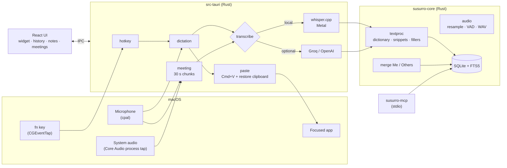

# Susurro

**Local voice dictation and meeting transcription for macOS.** Hold `fn`, speak, release — the text is pasted
into whatever app you're in. Everything runs on-device with [whisper.cpp](https://github.com/ggerganov/whisper.cpp)
on Metal; cloud transcription (Groq / OpenAI) is optional.

A from-scratch take on tools like Wispr Flow, built with **Tauri 2 + Rust + React**.

<!-- TODO: demo GIF. Record ~10 s: hold fn in a text editor, speak a sentence, release and show the pasted text.
     Save it as docs/demo.gif and uncomment the line below. -->
<!--  -->

> 🎬 _Demo GIF coming soon._

## Features

- **Push-to-talk dictation** — hold `fn` to dictate, double-tap `fn` (or `fn + space`) for hands-free, `Esc` to cancel.
  The text is pasted into the focused app and your clipboard is restored afterwards.
- **Voice notes** — dictate ideas to keep instead of pasting them.
- **Meeting transcription** — records your microphone (**Me**) and the system audio (**Others**) as separate
  tracks, transcribes them in 30 s chunks and merges both into a single speaker-labelled transcript.
- **Custom dictionary** — terms Whisper usually mishears ("n ocho n" → `n8n`), also fed to the model as a prompt.
- **Snippets** — say a trigger ("my signature") and get the full expansion.
- **Clean-up** — removes filler words and the classic Whisper hallucinations on silence ("Thanks for watching!").
- **Full-text search** over dictations, notes and meetings (SQLite FTS5).
- **MCP server** — lets Claude (or any MCP client) read your meetings and notes.
- **Private by default** — local models, API keys in the macOS Keychain, dictations expire after 24 h (configurable).
- Floating mini toolbar that never steals focus, menu-bar icon, onboarding for permissions.

## Architecture



| Crate / folder | What it does |
|---|---|
| `crates/susurro-core` | Platform-independent logic: database, text post-processing, audio utilities, meeting merge. Unit-tested. |
| `crates/susurro-mcp` | MCP server over stdio: `list_meetings`, `get_meeting_transcript`, `search_transcripts`, `list_dictations`, `list_notes`. |
| `src-tauri` | The macOS app: global hotkey, audio capture, transcription backends, pasting, permissions, floating panel, tray. |
| `src` | React UI: floating widget and main window. |

## Performance

Measured on an Apple A18 Pro (2 performance cores), 8.6 s of Spanish speech:

| Model | Time | Notes |
|---|---|---|
| `large-v3-turbo-q5` | 3.2 s | Best quality, default |
| `small-q5` | 0.85 s | Good for short dictations |

Flash attention brings turbo from 4.8 s to 3.2 s.

## Technical notes

- **`fn` as a hotkey.** A `CGEventTap` listens for the `fn` modifier and *consumes* it, so other apps (e.g. a
  terminal with its own dictation) don't react to the same key press.
- **System audio without screen recording.** Uses Core Audio *process taps* (macOS 14.2+): a global mono tap that
  excludes Susurro itself, wrapped in a private aggregate device. Earlier versions used ScreenCaptureKit, which
  needed the screen-recording permission and Swift runtime linking.
- **A floating panel that doesn't steal focus.** The widget is a non-activating `NSPanel`
  ([tauri-nspanel](https://github.com/ahkohd/tauri-plugin-nspanel)). Panels don't get reliable mouse enter/leave
  events, so hover is computed in Rust by polling the cursor position and sent to the webview.
- **Smaller `audio_ctx` was rejected**: 25 % faster, but Whisper started repeating sentences.
- **Hallucination filter.** Whisper invents text on silence; an energy-based VAD skips silent audio and a list of known phrases
  ("Subtítulos realizados por la comunidad de Amara.org"…) catches the rest.

## Install

Download the `.dmg` from [Releases](../../releases) (Apple Silicon, macOS 14.2+).

The build is **ad hoc signed** (no Apple Developer ID), so Gatekeeper will block the first launch. Either right-click
the app → **Open**, or run:

```sh
xattr -dr com.apple.quarantine /Applications/Susurro.app
```

On first launch Susurro asks for **Microphone**, **Accessibility** (to listen to `fn` and paste) and, for meetings,
**System audio recording**. Models are downloaded from Hugging Face on demand.

## Build from source

Requirements: macOS 14.2+, Rust (stable), Node 22, Xcode command line tools.

```sh
npm install
npm run tauri dev                         # run in development
npm test                                  # Rust tests + type check
npm run tauri build -- --bundles app      # build Susurro.app
```

There is also a CLI mode: `susurro --transcribe file.wav [--model small-q5]`.

> macOS ties permissions to the code signature, so with ad hoc signing every rebuild loses Accessibility.
> For day-to-day development create a self-signed certificate in Keychain Access, put its name in
> `src-tauri/tauri.local.conf.json` (git-ignored) and build with `npm run build:local`:
>
> ```json
> { "bundle": { "macOS": { "signingIdentity": "My Local Signing" } } }
> ```

### Use it from Claude

The app bundles `susurro-mcp`. Add it to your MCP client, e.g. Claude Code:

```sh
claude mcp add susurro /Applications/Susurro.app/Contents/MacOS/susurro-mcp
```

## License

[MIT](LICENSE)
